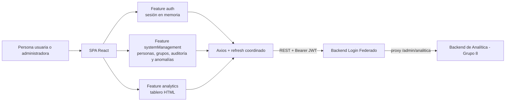

# CityPass+ — Login Federado Frontend

Aplicación web del Squad 2 para autenticación y administración de identidades de CityPass+. Implementa login, recuperación y cambio de contraseña, custodia de tokens en memoria, renovación automática y una interfaz de gestión de personas, grupos, membresías, auditoría y eventos de anomalía.

> Estado verificado: 18 de noviembre de 2026. Las rutas y los DTO del frontend están alineados con el contrato vigente de `CityPass_Login_Backend`.

## Stack exacto

| Área | Versión declarada |
|---|---|
| Runtime de build | Node.js 22 (`node:22-alpine`) |
| React / React DOM | 18.3.1 |
| TypeScript | 5.6.x |
| Vite | 5.4.x |
| React Router | 7.1.x |
| TanStack Query | 5.62.x |
| Zustand | 5.0.x |
| Axios | 1.7.x |
| React Hook Form / Zod | 7.54.x / 3.24.x |
| Tailwind CSS | 3.4.x |
| Vitest / Testing Library | 2.1.x / React 16.1.x |
| Accesibilidad automatizada | jest-axe 11.x |
| Runtime OCI | Nginx 1.27 Alpine, usuario no root |

Los rangos provienen de `package.json`; `package-lock.json` está ignorado y no se versiona, de modo que una instalación nueva no fija versiones transitivas exactas.

## Inicio local

Requisitos: Node.js 22, npm y backend accesible en `http://127.0.0.1:8081`.

```bash
npm install
```

Cree `.env`:

```dotenv
VITE_API_BASE_URL=/api
VITE_CLIENT_ID=citypass-admin-web
```

```bash
npm run dev
```

Abra `http://localhost:5173`. El proxy de Vite elimina `/api` y reenvía a `http://127.0.0.1:8081`.

### Docker

```bash
docker compose up -d --build
docker compose ps
```

El host publica `5173` y Nginx escucha en `8080` dentro del contenedor. `FRONTEND_PORT` permite cambiar el puerto host. `VITE_API_BASE_URL` es una variable de build: hay que reconstruir la imagen para cambiarla.

## Scripts

| Comando | Propósito |
|---|---|
| `npm run dev` | Vite con HMR |
| `npm run lint` | ESLint |
| `npm run typecheck` | TypeScript sin emisión |
| `npm test` | suite Vitest una vez |
| `npm run test:watch` | Vitest interactivo |
| `npm run test:coverage` | cobertura V8, umbral 60 % en las cuatro métricas |
| `npm run build` | typecheck y bundle de producción |
| `npm run preview` | preview del bundle |

Validación recomendada:

```bash
npm run lint
npm run typecheck
npm run test:coverage
npm run build
docker compose up -d --build --wait
```

## Arquitectura y seguridad del cliente

La organización es Feature-Driven:

```text
src/
├── components/ui/              # primitivas visuales compartidas
├── features/auth/              # login, refresh, logout, JWT y guards
├── features/analytics/         # proxy HTML y tablero para admin-global
├── features/systemManagement/  # personas, grupos, auditoría y anomalías
├── lib/axios.ts                # interceptores y coordinación de refresh
└── App.tsx                     # rutas y providers
```



- Access y refresh token se guardan únicamente en memoria; recargar la página obliga a iniciar sesión otra vez.
- El cliente renueva 30 segundos antes del vencimiento y usa una única promesa de refresh para solicitudes concurrentes.
- Un `401` protegido produce un solo refresh y reintento.
- El frontend decodifica claims para navegación, pero no verifica la firma: el backend sigue siendo la frontera de autorización.
- El panel exige `aud=citypass-admin-api`, `token_use=human` y `ver=1`. Un delegado requiere grupo `delegados` y módulo; el backend representa al administrador general mediante el grupo `admin-global`. El cliente conserva compatibilidad con `admin_scope=GENERAL` y aliases históricos de roles globales.

## Rutas de UI

| Ruta | Estado |
|---|---|
| `/login` | operativa contra `POST /auth/login` |
| `/home` | área autenticada básica |
| `/panel` | gestión combinada de usuarios, grupos y membresías |
| `/panel/users` | gestión exclusiva de usuarios |
| `/panel/groups` | gestión exclusiva de grupos y asignaciones |
| `/panel/audit` | historial administrativo paginado y filtrable |
| `/panel/anomalies` | revisión y aprobación de accesos bloqueados por anomalías |
| `/panel/analitica` | tablero HTML de Analítica de Identidad para `admin-global` |
| `/forgot-password` | solicitud pública de recuperación |
| `/reset-password?token=…` | restablecimiento mediante enlace de recuperación |
| `/reset-password` | cambio de contraseña para una sesión autenticada |
| `/unauthorized` | feedback de autorización |

## Contrato con el backend

La autenticación y el panel consumen las rutas inglesas publicadas por el backend vigente. Las llamadas principales son:

| Método | Ruta | Uso en la interfaz |
|---|---|---|
| `POST` | `/auth/login`, `/auth/refresh`, `/auth/logout` | sesión y renovación |
| `POST` | `/auth/forgot-password`, `/auth/reset-password`, `/me/change-password` | recuperación y cambio de contraseña |
| `GET` / `POST` / `PUT` | `/panel/people`, `/panel/people/{uid}` | listado, alta y modificación de personas |
| `POST` | `/panel/people/{uid}/disable`, `/enable`, `/unlock` | estado LDAP y desbloqueo temporal |
| `GET` | `/panel/admin/people`, `/panel/admin/groups` | vistas transversales del administrador general |
| `GET` | `/panel/modules` | catálogo de módulos |
| `GET` / `POST` / `DELETE` | `/panel/groups`, `/panel/groups/{name}` | gestión de grupos |
| `POST` / `DELETE` | `/panel/groups/{name}/members[/{uid}]` | membresía individual |
| `POST` | `/panel/group-memberships/bulk` | asignación masiva |
| `GET` | `/panel/audit` | auditoría con filtros y paginación |
| `GET` / `POST` | `/panel/anomaly-events`, `/panel/anomaly-events/{id}/approve` | revisión y aprobación de anomalías |
| `GET` | `/admin/analitica` | proxy autenticado del tablero HTML de Analítica |

Los listados admiten paginación y filtros. El alcance de módulo se deriva del token para delegados y se envía explícitamente cuando un administrador general opera sobre un módulo concreto.

El tablero de Analítica se solicita con el cliente HTTP autenticado para adjuntar el access token humano. El HTML recibido se muestra sin modificaciones mediante `iframe.srcDoc`, con `sandbox="allow-scripts"` y sin `allow-same-origin`; el token no se incluye en la URL ni se entrega al contenido embebido.

Un `401` devuelto por `/admin/analitica` no invalida la sesión local: esa ruta propaga el estado del servicio upstream y el rechazo puede corresponder a la firma o al issuer configurados entre ambientes. En desarrollo, el endpoint productivo de Analítica no acepta las claves RSA autogeneradas ni el issuer local; la integración completa debe probarse contra un ambiente de Analítica que confíe en el JWKS del IdP utilizado.

### Estados de cuenta y eventos de anomalía

- `disabled` representa una cuenta deshabilitada en LDAP.
- `locked` y `lockoutUntil` representan el bloqueo temporal por intentos fallidos.
- La acción **Desbloquear cuenta** solo aparece para una persona con `locked=true`; no rehabilita LDAP ni aprueba un evento de anomalía.
- La aprobación de anomalías habilita un único reintento acotado al contexto autorizado y actualiza las cachés de anomalías, personas y auditoría.

## UX, responsive y accesibilidad

- Las tablas de usuarios, grupos, auditoría y anomalías se presentan como fichas apiladas en pantallas pequeñas; los datos y acciones principales no requieren desplazamiento horizontal a 360 px.
- Los estados de carga, vacío y paginación usan regiones `status`/`aria-live` para anunciar cambios dinámicos.
- Los diálogos se construyen con Radix UI, administran foco inicial y retorno de foco, y se prueban junto con la navegación por teclado del menú de usuario.
- `prefers-reduced-motion` desactiva animaciones y reduce transiciones globalmente; skeletons y spinners incluyen además utilidades `motion-reduce`.
- `src/accessibility.test.tsx` ejecuta axe sobre login, usuarios, grupos, auditoría y anomalías.

El diseño fue trabajado en Figma según la trazabilidad de Jira, pero este repositorio no contiene actualmente una URL pública o export verificable. Debe agregarse aquí cuando el equipo publique el artefacto.

## Pruebas

La suite definida contiene **45 archivos y 208 pruebas**, incluidas pruebas de contrato HTTP, Analítica, layout, hooks, caché, routing, foco, teclado, viewport de 360 px y cinco verificaciones con axe. `vitest.config.ts` exige al menos 60 % en statements, branches, functions y lines.

## CI/CD

- `pr-checks.yml`: CI y smoke test Docker Compose en PRs a `main` y `develop`.
- `CI.yml`: lint, cobertura, build, SonarCloud, Gitleaks y Trivy.
- `push-checks.yml`: CI seguido de CD en pushes a `main` y `develop`.
- `CD.yml`: artefacto inmutable de Vercel e imagen publicada en GHCR.
- `manual-deploy.yml`: despliegue a Vercel de un artefacto previamente validado.

El smoke test comprueba que Nginx sirve HTML; no prueba login ni compatibilidad con el backend.

## Credenciales de desarrollo

Con el backend seed, use `delegado-rec` / `changeit123` y `VITE_CLIENT_ID=citypass-admin-web`. Estas credenciales no son aptas para ambientes compartidos.

## Documentación

- `docs/README.md` — índice técnico de la TASK-171.
- `docs/guides/frontend-architecture.md`
- `docs/guides/create-new-feature.md`
- `docs/guides/style-guide.md`
- `src/accessibility.test.tsx`
- `docs/adr/`
- Documentación integral y diagramas: carpeta `login-federado/docs/` del repositorio backend.
