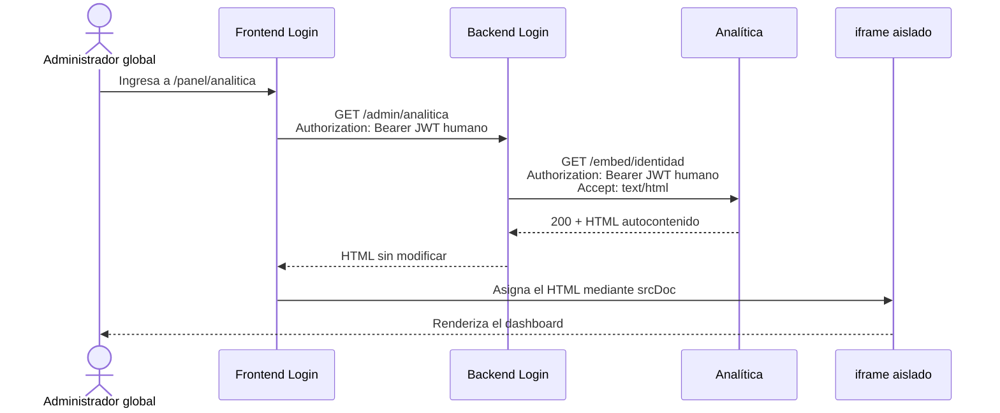

# Integración frontend con el dashboard de Analítica

**Última actualización:** 19 de noviembre de 2026  
**Alcance:** portal administrativo de Login Federado  
**Ruta de usuario:** `/panel/analitica`  
**Endpoint consumido:** `GET /admin/analitica`

## Objetivo

Integrar dentro del portal administrativo de Login Federado el dashboard de
Identidad construido por el módulo de Analítica. El tablero debía quedar
disponible únicamente para `admin-global`, reutilizar la sesión humana existente
y evitar que el access token se expusiera en la URL o dentro del HTML recibido.

El frontend no llama directamente al servicio de Analítica. Consume el proxy
autenticado de Login Federado, que reenvía el JWT humano a
`/embed/identidad` y devuelve el documento HTML autocontenido.

## Contexto y cronología de la integración

La integración se realizó con una ventana muy reducida respecto de la fecha de
entrega. Esta cronología explica varias decisiones defensivas incorporadas en el
frontend:

| Momento aproximado | Situación |
| --- | --- |
| Domingo 15 de noviembre por la noche | Se recibió la guía de integración, muy cerca de la entrega. La versión inicial indicaba que Identidad todavía no recibía HTML y que `/embed/identidad` conservaba solamente una prueba autenticada en JSON. |
| Lunes 16 de noviembre | El equipo de Analítica informó que el HTML sí iba a estar disponible y compartió la URL base con la convención `/embed/{modulo}`. Esto contradijo parcialmente la guía recibida y obligó a revisar el diseño ya analizado. |
| Lunes 16, durante las primeras pruebas | Un login productivo seguido de `GET /embed/identidad` devolvía `200 OK`, pero con `{"status":"ok"}` en lugar del HTML. La autenticación funcionaba, pero todavía no existía un tablero que el frontend pudiera renderizar o validar. |
| Lunes 16, durante el desarrollo | Se implementaron el proxy backend y la estructura frontend con estados de carga, error y reintento. La validación visual end-to-end continuó bloqueada porque Analítica todavía no entregaba el artefacto HTML definitivo. |
| Cerca de la medianoche entre el lunes 16 y el martes 17 | `/embed/identidad` comenzó a devolver el HTML autocontenido real, con `Content-Type: text/html; charset=utf-8` y el bloque `citypass-datos`. Recién en ese momento se pudo validar la integración completa. |
| Pruebas posteriores | En local apareció un `401` esperado: un JWT firmado con issuer y claves locales no es aceptado por Analítica productiva. También se comprobó que el proxy productivo devolvía `404` mientras la versión nueva del backend todavía no había sido desplegada. |

El retraso y los cambios de contrato redujeron el tiempo disponible para pruebas
integradas. Por eso se priorizaron una separación clara del código, errores
específicos por estado HTTP, aislamiento del HTML y pruebas automatizadas del
comportamiento que sí podía verificarse sin depender del upstream.

## Flujo final



El access token viaja solamente en `Authorization`. No se incorpora en query
parameters, no se concatena a la URL y no se inserta en el HTML del dashboard.

## Cambios realizados en el frontend

### 1. Feature de Analítica

Se creó `src/features/analytics/` siguiendo la arquitectura por features del
proyecto:

- `api/analyticsApi.ts`: contrato HTTP con el proxy.
- `api/analyticsApi.test.ts`: prueba de la solicitud y su configuración.
- `pages/AnalyticsPage.tsx`: estados visuales y renderizado del dashboard.
- `pages/AnalyticsPage.test.tsx`: pruebas de carga, éxito, errores y reintento.

### 2. Cliente HTTP autenticado

`fetchAnalyticsHtml` realiza:

```http
GET /admin/analitica
Accept: text/html
Authorization: Bearer <access-token-humano>
```

La configuración relevante es:

- `responseType: "text"`, para impedir que Axios intente interpretar el HTML
  como JSON.
- Timeout de 25 segundos, superior a los timeouts combinados del proxy backend.
- `_preserveSessionOnUnauthorized: true`, para distinguir un rechazo del
  upstream de una sesión local vencida.

El interceptor de Axios fue extendido para que un `401` de este proxy no borre
la sesión ni redirija automáticamente al login. Esto fue necesario porque, en
desarrollo, el backend local puede aceptar su propio JWT y recibir después un
`401` de Analítica productiva por diferencias de issuer o JWKS.

### 3. Página y estados de interfaz

La pantalla `AnalyticsPage` incorpora:

- Estado de carga accesible con `role="status"` y `aria-live="polite"`.
- Mensaje de error con `role="alert"`.
- Botón `Reintentar`, que ejecuta nuevamente la consulta sin cerrar la sesión.
- Mensajes específicos para:
  - `401`: Analítica no pudo validar el token del entorno.
  - `403`: el usuario no es administrador global.
  - `502`: el upstream respondió exitosamente, pero el backend rechazó el
    contenido porque no era HTML válido.
  - `503`: Analítica no está disponible.
  - Timeout: el tablero superó el tiempo máximo de espera del frontend.

TanStack Query se configuró sin reintentos automáticos y sin refresco al volver
el foco a la ventana. De este modo, una respuesta pesada o una falla del servicio
no dispara solicitudes adicionales inesperadas.

### 4. Renderizado aislado del HTML

El HTML se muestra mediante:

```html
<iframe
  title="Tablero de Analítica de Identidad"
  sandbox="allow-scripts"
  srcdoc="...html recibido..."
></iframe>
```

Decisiones principales:

- `allow-scripts` permite ejecutar los scripts autocontenidos del dashboard.
- No se usa `allow-same-origin`, por lo que el contenido embebido queda en un
  origen opaco y no puede acceder al contexto del portal.
- El token permanece en la capa HTTP del frontend y nunca se entrega al iframe.
- Se usa `srcDoc` porque un `<iframe src>` tradicional no puede adjuntar el
  header `Authorization` requerido por el backend stateless.

#### Trade-off conocido

Una cabecera CSP recibida en la petición XHR no se aplica automáticamente al
documento creado mediante `srcDoc`. El aislamiento efectivo actual depende del
atributo `sandbox`. Si en el futuro se exige aplicar directamente la CSP HTTP de
Analítica, será necesario migrar a un flujo con sesión o cookie `HttpOnly` de
mismo origen que permita usar un `iframe src` sin colocar el token en la URL.

### 5. Autorización y navegación

La opción **Analítica** se agregó al menú administrativo, pero se muestra
solamente cuando la sesión contiene el grupo `admin-global`.

También se agregó `GlobalAdminRoute`, que protege `/panel/analitica` y redirige
a `/unauthorized` cuando un usuario intenta acceder sin ese grupo. Esta
protección visual mejora la experiencia, pero no reemplaza la autorización del
backend.

### 6. Ajustes del layout

Durante la integración se detectó que las páginas administrativas permitían
desplazarse más allá del contenido y mostraban una zona de fondo vacía. El shell
del panel se ajustó para:

- Ocupar exactamente el alto dinámico del viewport con `h-dvh`.
- Evitar el scroll del documento raíz.
- Concentrar el desplazamiento vertical en el área principal.
- Mantener la barra lateral a altura completa y con scroll propio cuando sea
  necesario.

Este ajuste también evita que el iframe de 1200 px genere un segundo espacio de
scroll fuera del panel.

### 7. Validación local y Docker

Se corrigieron los healthchecks del contenedor frontend para consultar
`127.0.0.1:8080`, evitando resoluciones ambiguas de `localhost` dentro de la
imagen Nginx.

La validación final incluyó:

- 45 archivos de pruebas.
- 208 pruebas aprobadas.
- Build de producción exitoso.
- ESLint sin errores.
- TypeScript sin errores.
- Imagen Docker construida correctamente.
- Contenedor frontend en estado `healthy`.
- Respuesta `200` de `/panel/analitica` en el servidor local.

## Pruebas agregadas o ampliadas

| Área | Cobertura |
| --- | --- |
| API de Analítica | URL del proxy, `Accept: text/html`, respuesta textual, timeout y preservación de sesión. |
| Página de Analítica | Carga, iframe aislado, HTML recibido, `503`, reintento, `401`, `502` y timeout. |
| Routing | Acceso de `admin-global` y rechazo de usuarios sin alcance global. |
| Store de autenticación | Selector de acceso a Analítica basado en grupos. |
| Sidebar | Visibilidad y estado activo del enlace según permisos. |
| Runtime HTTP | Un `401` del proxy no elimina una sesión válida. |
| Layout | Scroll contenido dentro del viewport y sidebar a altura completa. |

## Problemas encontrados y resolución

### El endpoint respondía `200`, pero no entregaba HTML

Durante las primeras pruebas `/embed/identidad` devolvía
`{"status":"ok"}`. El estado HTTP confirmaba que el JWT era aceptado, pero no
que existiera un dashboard consumible. La integración se mantuvo preparada y se
validó recién cuando el upstream comenzó a responder `text/html` con contenido
no vacío.

El backend ahora trata una respuesta `2xx` vacía o que no sea HTML como `502` y
el frontend comunica ese caso de manera explícita.

### `401` al probar contra Analítica productiva desde local

El JWT local contiene issuer y firma locales. Analítica productiva confía en el
issuer y el JWKS productivos, por lo que el rechazo es correcto. No se copiaron
claves privadas productivas ni se relajó la validación.

Las alternativas seguras son:

- Probar con un ambiente de Analítica que confíe en el JWKS local.
- Apuntar temporalmente el frontend local al backend productivo desplegado.
- Ejecutar el smoke test con un token emitido por el IdP productivo.

### Redirección al login ante un error exclusivo de Analítica

El interceptor global interpretaba cualquier `401` como expiración de la sesión.
Para el proxy de Analítica esto era incorrecto: el backend local podía aceptar el
JWT y el upstream rechazarlo después. La marca
`_preserveSessionOnUnauthorized` permite mostrar el error dentro del panel sin
desconectar al administrador.

### Proxy productivo todavía no desplegado

Antes del despliegue de la versión backend, `GET /admin/analitica` respondía
`404`. El frontend no debe reemplazar ese endpoint por una llamada directa a
Analítica: la solución correcta es desplegar el proxy y conservar el límite de
seguridad backend-to-backend.

## Archivos principales

- [`src/features/analytics/api/analyticsApi.ts`](../../src/features/analytics/api/analyticsApi.ts)
- [`src/features/analytics/pages/AnalyticsPage.tsx`](../../src/features/analytics/pages/AnalyticsPage.tsx)
- [`src/features/auth/routing/GlobalAdminRoute.tsx`](../../src/features/auth/routing/GlobalAdminRoute.tsx)
- [`src/features/auth/store/useAuthStore.ts`](../../src/features/auth/store/useAuthStore.ts)
- [`src/features/systemManagement/components/layout/ManagementSidebar.tsx`](../../src/features/systemManagement/components/layout/ManagementSidebar.tsx)
- [`src/features/systemManagement/components/layout/ManagementPageLayout.tsx`](../../src/features/systemManagement/components/layout/ManagementPageLayout.tsx)
- [`src/lib/axios.ts`](../../src/lib/axios.ts)

## Resultado

El portal administrativo quedó preparado para mostrar el dashboard real de
Identidad sin exponer el token al contenido embebido, con acceso restringido a
`admin-global`, manejo explícito de fallas del upstream y una experiencia de
reintento que no invalida la sesión general.

La integración completa depende de dos condiciones externas: que el backend con
`/admin/analitica` esté desplegado y que Analítica entregue el HTML definitivo
confiando en el issuer y el JWKS del IdP utilizado.
